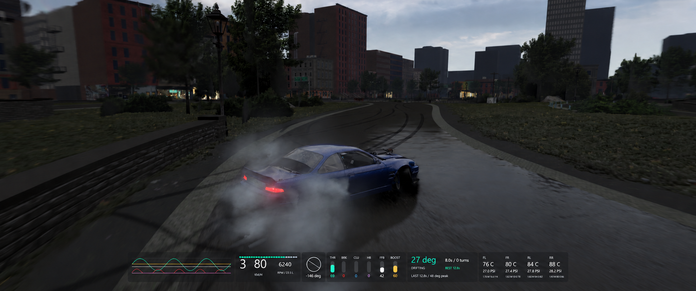

# Drift HUD

A compact, modular drift HUD for Assetto Corsa and Custom Shaders Patch.

*Illustrative overlay on a game screenshot, using sample telemetry and 20% panel backgrounds.*

## Features

- **Inputs, left:** eight seconds of throttle, brake, clutch, handbrake, FFB and boost history.
- **Driving info, middle:** gear, speed, RPM, fuel, steering, input meters, slip angle and run stats.
- **Tyres, right:** temperatures and pressures for all four wheels.
- **Flexible layout:** bottom-centred docking, automatic recentring when panels are hidden, or independent placement.
- **Practice history:** recent runs and best drift duration for each track, layout and car.

## Install

Requires **Assetto Corsa**, **Content Manager** and **CSP with Lua app support**. Tested on CSP **0.3.0-preview649**. Pure is not required.

1. Close the driving session.
2. Copy `apps/lua/DriftHUD/` into the matching folder inside your Assetto Corsa game installation.
3. Check that `apps/lua/DriftHUD/DriftHUD.lua` exists inside the game folder.
4. Enable **Drift HUD** if it is listed in Content Manager's app settings, then start a new session.
5. Open **Drift HUD Settings** from AC's app sidebar to customise it. The three HUD panels open by default.

## Make it yours

In **Drift HUD Settings**, you can:

- Hide individual modules, the input graph or tyre panel.
- Disable unused channels, such as clutch or handbrake.
- Switch speed between km/h and MPH, or invert the clutch reading.
- Adjust background opacity from transparent to solid.
- Turn off docking to move and resize panels yourself.

Close a panel from the app sidebar to recenter the others for that session. Use the settings toggles to keep Inputs or Tyres hidden on future loads.

## Practice runs

Drift timing starts above **20 km/h** at **12–80° slip angle**. Short straight gaps can link transitions. Completed runs are saved in **Practice history**; replays and spectating do not add records. Tyre values are readings, not setup recommendations.

## Updating or removing

Replace the app folder to update, then restart the session. To uninstall, delete only `apps/lua/DriftHUD/`.

Preferences and practice records are saved separately. Back them up before resetting settings; see the [detailed guide](docs/guide.md) for paths, troubleshooting, code changes and tests.

## License

[PolyForm Noncommercial 1.0.0](LICENSE.md): use, modify and share for noncommercial purposes under its terms. Commercial use needs separate permission. [Third-party notices](NOTICE.md).
