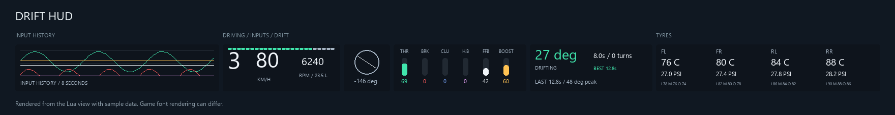
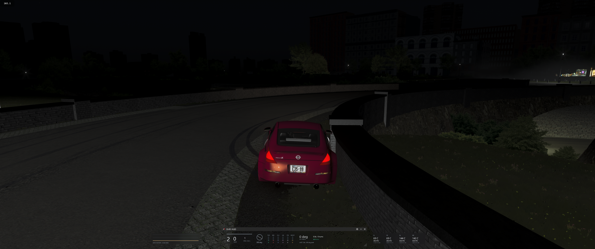

# Drift HUD for Assetto Corsa

A compact drift telemetry HUD with separate input-history, driving-information and tyre panels. Keep the full strip at the bottom of the screen, hide what you do not use, or place each panel yourself.



*Preview rendered from the actual Lua drawing code with sample telemetry. It is not an in-game screenshot; font rendering can differ in AC.*

## What is included

- **Input history on the left:** an eight-second graph for throttle, brake, clutch, handbrake, FFB and boost.
- **Driving information in the middle:** gear, speed, RPM, fuel, steering, individual input meters, slip angle and practice-run statistics.
- **Tyres on the right:** four-wheel core temperature, pressure and inner/middle/outer temperatures.
- **Practice history:** completed player runs grouped by track, layout and car, with recent runs and personal best duration.
- **A separate settings window:** choose units, toggle modules and channels, set background opacity and switch between docking and free placement.

All three HUD windows open by default. Docking centres the visible group along the bottom edge and closes gaps when panels are hidden. The background defaults to 18% opacity and can be made fully transparent. Numbers below input bars are centred using their rendered text width, so one-, two- and three-digit values stay aligned.

## Requirements and compatibility

You need Assetto Corsa, Content Manager and Custom Shaders Patch with Lua app support. This app is independent of Pure, Pure Planner, Atmosphere Dynamics and any other HUD.

Development and user testing have used **CSP 0.3.0-preview649**, a **CW 350Z 2JZ-GTE**, **Brooklyn Park** and a single **3440 × 1440 display**. The latest release includes updated window bounds and bottom-edge alignment; those changes have source tests and a rendered preview, but still need final in-game confirmation. No minimum CSP version or VR/triple-screen compatibility is claimed.

## Install

1. Close the AC driving session.
2. Extract this repository or an installation ZIP.
3. Copy `apps/lua/DriftHUD/` into the matching folder under your AC installation. A typical game root is `C:\Program Files (x86)\Steam\steamapps\common\assettocorsa`.
4. Confirm the installed entry point is `assettocorsa/apps/lua/DriftHUD/DriftHUD.lua`. The directory contains `DriftHUD.lua`, `history.lua`, `layout.lua`, `manifest.ini`, `telemetry.lua` and `view.lua`.
5. If Content Manager lists Lua apps that must be enabled, enable **Drift HUD** there. Start a new driving session and look in AC's app sidebar.
6. Open **Drift HUD Settings** to customise the panels. **Practice history** is a separate window.

Copy the `apps` contents into the game root, not the repository folder itself. You do not need to install another HUD, copy vendor assets or change game physics.

## Layout and controls

### Docked layout

**Dock panels at bottom centre** starts enabled. The visible panels are ordered **Inputs → main information → tyres**. Their windows are sized from the same module geometry used for drawing. The group uses the UI-scaled AC window dimensions, maintains its aspect ratio on narrower screens and anchors its bottom at the screen edge.

Close a panel from the app sidebar to remove it from the visible group; the others recenter. Hidden/collapsed panels do not reserve docking width. Disabling a module inside the middle panel also reduces that panel's width.

By default, the main panel opens when the app loads, while Inputs and Tyres follow their saved settings. Closing windows is a session-level visibility action; use the settings checkboxes when you want Inputs or Tyres to remain disabled after the next load.

### Free placement

Turn off docking to move and resize the windows independently. The drawing fits inside the available content area, so saved window dimensions should not crop the numbers. Restart after changing a manifest or installing an update; live Lua reload does not reliably reload all window metadata.

### Settings

- **Speed in MPH:** converts the displayed speed; run detection continues to use km/h internally.
- **Invert clutch telemetry:** changes both the clutch bar and its graph. Check the value with your foot off the pedal and choose the polarity that reads zero when released.
- **Dock panels at bottom centre:** automatic group placement or independent manual placement.
- **Speed, gear, RPM and fuel:** show/hide the primary driving module.
- **Steering indicator:** show/hide the wheel-angle module.
- **Input meters:** show/hide the vertical meter module.
- **Tyres:** show/hide the separate tyre window.
- **Input history:** show/hide the separate graph window.
- **Drift angle and practice runs:** show/hide live slip angle, current run and last/best summaries. Hiding the view does not stop telemetry collection.
- **Background opacity:** from zero (transparent) to one (solid). This changes the panel fill, not the visibility of text or traces.
- **Channel checkboxes:** independently show throttle, brake, clutch, handbrake, FFB and boost in both the meters and graph. A Moza R3 without a clutch or handbrake can hide those unused channels.

The reset button discards the current practice run and graph. It does **not** delete saved completed runs.

## Reading the HUD

Speed, fuel and tyre values come from CSP telemetry. Tyre temperatures are degrees Celsius and pressures are PSI; they are observations, not recommended setup targets. `FL`, `FR`, `RL` and `RR` identify the wheels; `I/M/O` are inner/middle/outer temperatures.

Input values are clamped to 0–100%. FFB uses the magnitude of final force feedback; boost uses the provided telemetry value on the same 0–1 meter scale. These are not a steering torque measurement or a calibrated boost-pressure gauge. Missing FFB/boost/tyre physics data is shown as unavailable where supported; a valid zero input remains zero.

Slip angle uses horizontal velocity relative to horizontal body heading, not steering lock. The main view displays the absolute angle. The drift timing rules below are separate from displaying telemetry.

## Practice runs and records

A qualifying slide is forward motion at **20 km/h or above**, with an angle between **12° and 80°**, outside the pits. Straight gaps up to **0.7 seconds** can link turns, but the straight portion does not add drift time. Crossing sides during a linked run increments the transition count.

A spin beyond the reset threshold, reverse motion, entering the pits or a long enough gap ends a run. Runs of at least **one second** can be saved. Teleports and discontinuous updates discard the unfinished run rather than inventing elapsed time. Pause does not add time.

Only the player's live driving contributes saved records. Replays and spectating remain telemetry views. Practice history keeps the **latest 500 runs** and best duration for up to **500 track/layout/car combinations**. Conditions, tyres, assists and setups may differ, so this is a personal practice log rather than a competitive score.

## In-game reference



*Real user capture: CW 350Z 2JZ-GTE at Brooklyn Park at night. This was taken before the final window-bounds cleanup and shows the previous title bar/spacing. Use the generated preview above for the current panel contents; this capture is retained as an honest in-game reference.*

## Updating, resetting and uninstalling

Close the driving session and replace only `apps/lua/DriftHUD/`. Preferences and practice history live separately under `Documents/Assetto Corsa/cfg/extension/state/lua/app/DriftHUD.ini`, so copying the app does not normally remove them. That file also contains completed practice records: **back it up before clearing it**.

CSP stores window positions in `Documents/Assetto Corsa/cfg/extension/state/imgui_settings.ini`. If an old layout survives an update, close AC, back up the file and remove only entries beginning `IMGUI_LUA_Drift HUD`. Do not delete the whole shared settings file. Docking should apply the current geometry on the next load without a manual reset.

To uninstall, close AC and remove only `apps/lua/DriftHUD/`. Keep the saved-state file if you may return to the app. Removing it also removes the stored history. Other HUDs, Pure and game settings are unaffected by uninstalling the app.

## Modifying the HUD

The app separates data collection, display and positioning so you can change one without rewriting everything:

- [`DriftHUD.lua`](../apps/lua/DriftHUD/DriftHUD.lua) owns persistent preferences, CSP callbacks, focused-car selection and the settings/history windows.
- [`telemetry.lua`](../apps/lua/DriftHUD/telemetry.lua) computes slip angle, samples input history and detects practice runs.
- [`history.lua`](../apps/lua/DriftHUD/history.lua) validates stored JSON and keeps recent runs and bests. Invalid/future history is retained read-only instead of overwritten.
- [`view.lua`](../apps/lua/DriftHUD/view.lua) defines the module geometry and draws it. `size()` exposes the same dimensions to docking, and `draw()` uses the available content area.
- [`layout.lua`](../apps/lua/DriftHUD/layout.lua) opens the default windows, orders visible panels and applies bottom docking using CSP window accessors.
- [`manifest.ini`](../apps/lua/DriftHUD/manifest.ini) declares the main, Inputs, Tyres, Settings and Practice history windows.

Input history is a **160-sample ring buffer at 20 Hz**. The graph walks from the oldest live sample towards the head, so wrapping does not reverse it. Timing uses seconds from the frame update; docking uses UI-scaled pixels from `ac.getSim().windowSize`. Text centring measures the same DirectWrite font size used to draw it.

When adding a module, keep `view.lua`'s geometry and drawing together. Do not add a second set of guessed widths in `layout.lua`. If a change affects persisted data, preserve or migrate the schema rather than overwriting unknown JSON. Keep run detection separate from display toggles so hiding a panel does not change the records.

### Run checks

From the repository root:

```powershell
python -m venv .venv
.venv\Scripts\python.exe -m pip install -r requirements-dev.txt
.venv\Scripts\python.exe tests/run_lua_tests.py
```

The source suite includes **13 telemetry/app checks** and **19 docking scenarios** covering full/partial panels, several screen widths, aspect ratio, centring, bottom bounds and free placement. CSP calls are simulated; these checks do not replace an in-game layout, font or performance check.

### Generate a preview

```powershell
.venv\Scripts\python.exe tools/preview_drift_hud.py --output docs/images/hud-preview.png
```

This runs the actual Lua view against sample data using Pillow for drawing. It is useful for reviewing modules without starting AC, but does not reproduce CSP's exact DirectWrite rasterisation or window behaviour. The preview supports Segoe UI on Windows, Helvetica on macOS and DejaVu Sans on Linux.

### Build an install ZIP

```powershell
python tools/build.py
```

The result is `dist/drift-hud-v0.4.zip`, containing the game-root-relative app files, this README and license notices. No vendor code, game runtime, personal telemetry or saved settings are included.

## License

[PolyForm Noncommercial License 1.0.0](../LICENSE.md). Noncommercial use, modification and sharing are permitted under its terms. Commercial use, including paid products incorporating this software, requires a separate permission from the licensor. This is source-available software. See [NOTICE.md](../NOTICE.md) for third-party product and screenshot notices.
